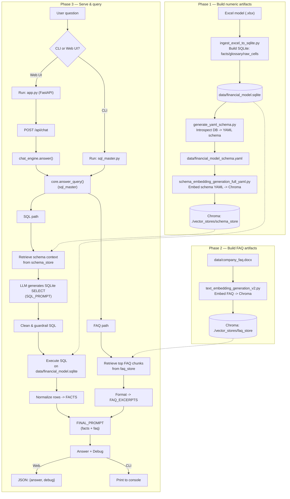

# Fundraise SQL + FAQ Chatbot (SQLite + Chroma)

This repo contains a Q&A assistant that can run **SQL retrieval** (for numeric/structured questions) and **FAQ retrieval** (for qualitative questions), backed by local assets (SQLite + Chroma) and optionally exposed via a lightweight **FastAPI web app**.

> **No data is included.** Bring your own company financial model (`.xlsx`) and investor FAQ (`.docx`), place them in `./data/` (git-ignored), and run the build phases below.

---

### Preparation
1. Create a python virtual environment (either via Anaconda/ command line venv)
2. Install requirements.txt (pip install -r "requirements.txt")
3. Run "chat_model_save.py" to download local instance of QWEN being used here
4. If Hugging Face asks for authentication, set your own token as an environment variable (`HF_TOKEN=<your token>`) or run `huggingface-cli login`. Never commit tokens.
5. Put your inputs in `./data/`: `financial_model.xlsx` and `company_faq.docx`

## Repository workflow (end-to-end)

There are **three** phases:

### Phase 1 — Build numeric artifacts (Excel → SQLite → schema store)
1. **Ingest Excel → SQLite** (`ingest_excel_to_sqlite.py`)
2. **SQLite → YAML schema** (`generate_yaml_schema.py`)
3. **YAML schema → Chroma schema store** (`schema_embedding_generation_full_yaml.py`)

### Phase 2 — Build qualitative artifacts (FAQ DOCX → FAQ store)
4. **FAQ DOCX → Chroma FAQ store** (`text_embedding_generation_v2.py`)

### Phase 3 — Serve & query (CLI or Web UI)
- **CLI**: run `sql_master.py`
- **Web UI**: run `app.py` (FastAPI) which calls into `chat_engine.py` → core pipeline

---

## What’s in this repo

### Runtime (core chatbot)
- **`sql_master.py`** – Core orchestration:
  - Loads a local LLM (OpenVINO Qwen) for SQL generation and final response generation.
  - Retrieves schema context from the schema vector store to guide SQL generation.
  - Executes SQL against `./data/financial_model.sqlite`.
  - Retrieves FAQ chunks from `./vector_stores/faq_store`.
  - Produces debug output: executed SQL, rows, FACTS, FAQ excerpts.

### Web app (frontend + API)
- **`app.py`** – FastAPI server that hosts a local “Copilot-style” chat UI and exposes REST endpoints:
  - Serves `static/index.html` via `/` and static assets under `/static`.
  - Creates in-memory chat sessions via `/api/session`.
  - Sends chat messages to the backend via `/api/chat` and returns `answer` + `debug`.
  - Initializes the model at startup by calling `chat_engine.init()`.

- **`chat_engine.py`** – Thin wrapper around the core pipeline for the web app:
  - Imports `sql_master` as `core`.
  - Loads the LLM + chains once at startup (`init()`), guarded by a lock.
  - Provides `answer(message)` returning `{answer, debug}`.
  - Includes a small patch to avoid the “FAQ fallback path == primary path” misconfiguration.

### Pre-processing (numeric model → SQLite → schema store)
- **`ingest_excel_to_sqlite.py`** – Ingests an entire Excel workbook into a query-friendly SQLite DB:
  - Produces `facts(metric, period, period_type, value, sheet, unit)` plus `glossary`, `sheet_registry`, `raw_cells`.

- **`generate_yaml_schema.py`** – Generates an LLM-friendly YAML schema from SQLite:
  - Outputs table/column/index metadata + sample rows.
  - Adds LLM SQL rules and a query playbook focused on the `facts` table.

- **`data/financial_model_schema.yaml`** – Generated schema artifact used for embedding and reference.

- **`schema_embedding_generation_full_yaml.py`** – Embeds the YAML schema into Chroma:
  - Task-optimized chunking + token-aware splitting.
  - Persists by default to `./vector_stores/schema_store`.

### Pre-processing (FAQ → vector store)
- **`text_embedding_generation_v2.py`** – Builds the FAQ Chroma store from a DOCX:
  - Parses the FAQ into Q/A “atomic” documents.
  - Adds metadata: `section`, `question`, `qid`, `intent`, `answer_type`.
  - Persists by default to `./vector_stores/faq_store`.

### Source documents
- **`data/company_faq.docx`** – Word document used for qualitative retrieval.

---

## End-to-end flowchart

> GitHub renders Mermaid diagrams automatically.



---

## Setup & prerequisites

You’ll need a Python environment that supports:
- `fastapi`, `uvicorn` (web server)
- `chromadb`
- `langchain_community`, `langchain_core`, `langchain_huggingface`
- `transformers`
- `optimum-intel` (OpenVINO)
- `openpyxl` (Excel ingestion)
- `pyyaml` (schema generation)
- `docx2txt` loader dependencies (FAQ ingestion)

> The embedding model used for building and querying stores should match (default: `sentence-transformers/all-MiniLM-L6-v2`).

---

## Phase 1 — Build numeric artifacts

### 1) Ingest Excel → SQLite

```bash
python ingest_excel_to_sqlite.py \
  --excel data/financial_model.xlsx \
  --sqlite data/financial_model.sqlite
```

### 2) Generate YAML schema from SQLite

```bash
python generate_yaml_schema.py \
  --sqlite data/financial_model.sqlite \
  --out data/financial_model_schema.yaml
```

### 3) Build schema vector store from YAML

```bash
python schema_embedding_generation_full_yaml.py \
  --schema data/financial_model_schema.yaml \
  --persist ./vector_stores/schema_store \
  --tokenizer ./models/qwen_tokenizer
```

---

## Phase 2 — Build FAQ artifacts

```bash
python text_embedding_generation_v2.py \
  --docx "data/company_faq.docx" \
  --persist "./vector_stores/faq_store" \
  --embed_model "sentence-transformers/all-MiniLM-L6-v2" \
  --tokenizer "./models/qwen_tokenizer"
```

---

## Phase 3 — Serve & query

### CLI mode

```bash
python sql_master.py
```

### Web UI mode

```bash
python -m uvicorn app:app --reload --port 8000
```

Then open:
- `http://localhost:8000`

API endpoints (local):
- `POST /api/session` → creates a new session id
- `POST /api/chat` → sends a message, returns `{answer, debug}`
- `GET /api/history/{session_id}` → returns stored messages for that session
- `POST /api/reset/{session_id}` → clears session history

---

## Troubleshooting notes

- If the Web UI loads but answers fail, check that `chat_engine.init()` succeeds at startup and that the vector store / DB paths match the ones inside the core script.
- If FAQ retrieval is empty, confirm the Chroma store exists at `./vector_stores/faq_store` and contains vectors.
- If schema retrieval seems weak, rebuild the YAML + schema store after re-ingesting the Excel model.

---

## References (repo files)

**Web app:**
- `app.py`
- `chat_engine.py`

**Pre-processing:**
- `ingest_excel_to_sqlite.py`
- `generate_yaml_schema.py`
- `data/financial_model_schema.yaml`
- `schema_embedding_generation_full_yaml.py`
- `text_embedding_generation_v2.py`

**Core runtime:**
- `sql_master.py`

**Sources:**
- `data/company_faq.docx`
